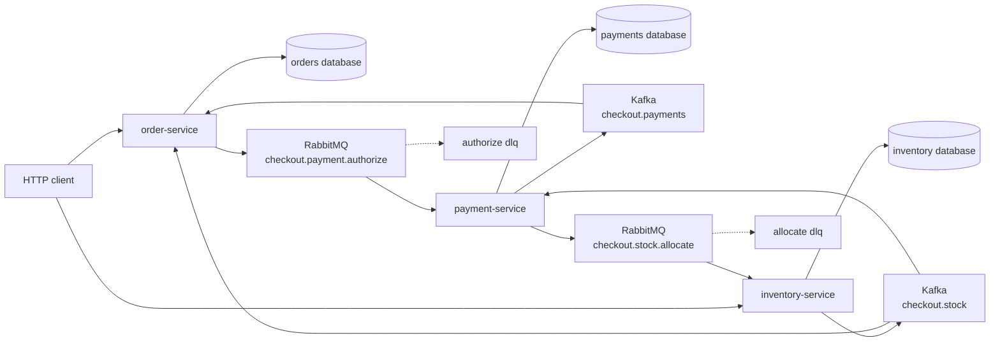
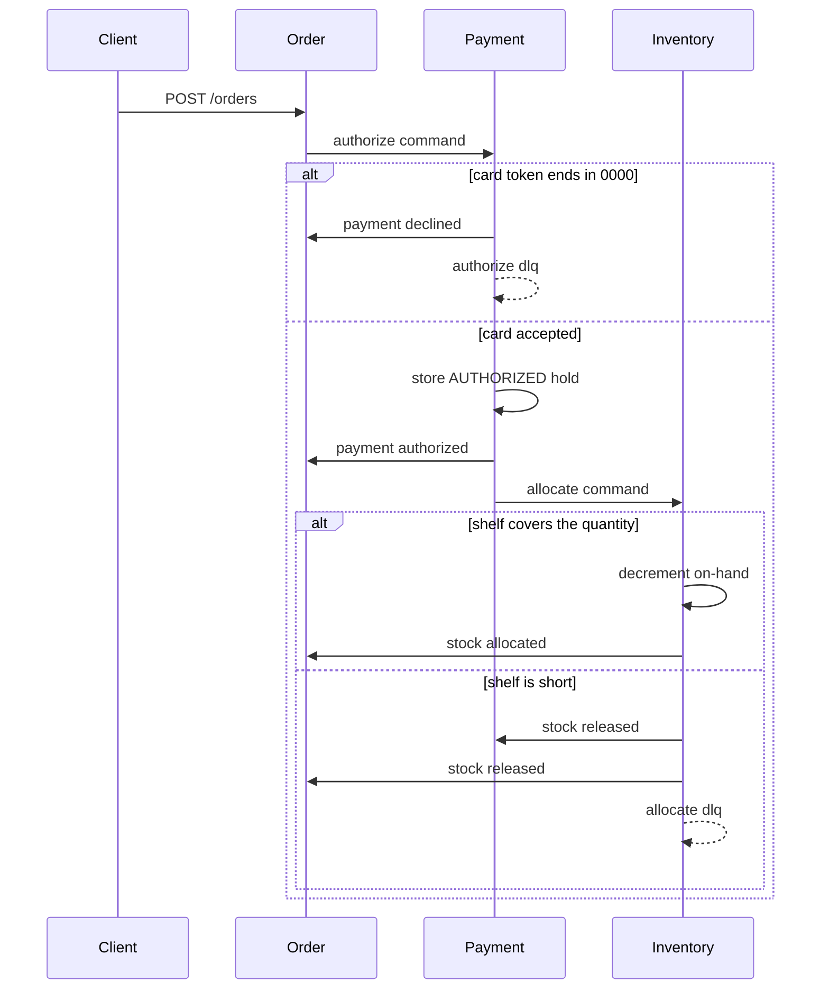

# Checkout Counter

A shop takes an order for one SKU. Payment authorizes a hold, then inventory allocates the units. If the shelf cannot cover the order, the hold is released and the order is cancelled. A card token that ends in `0000` is declined before any hold is written.

The three services do not call each other. The order service stores the order and enqueues authorization. Kafka carries the payment decision and the stock decision. RabbitMQ carries the authorize task and the allocate task.





## Why three services

The order row is the request. The hold is the payment service's own row. The shelf count lives only in inventory, and overlapping allocations subtract with one conditional update, so two orders cannot take the last unit twice.

A declined card never opens a hold. An allocation that cannot be filled publishes the release and then rejects the task onto `checkout.stock.allocate.dlq`. The payment service credits the hold to `RELEASED` when it reads that fact. The order becomes `CANCELLED`.

The broker send for a new hold runs after the hold row commits. There is no outbox. A crash after that commit and before the broker accepts the allocate command leaves an authorized hold with no stock task.

## Run

JDK 17, Maven 3.9, and Docker.

```bash
mvn -q -DskipTests package
docker compose up --build -d
./scripts/smoke.sh
```

| Process | URL |
| --- | --- |
| order-service | http://localhost:8111 |
| payment-service | http://localhost:8112 |
| inventory-service | http://localhost:8113 |
| RabbitMQ management | http://localhost:15676 |
| Postgres | localhost:5436 |
| Kafka (host listener) | localhost:9097 |

```bash
docker compose down
```

## Calls

```bash
curl -s -X POST localhost:8113/skus \
  -H 'content-type: application/json' \
  -d '{"sku":"MUG","onHand":5}'

curl -s -X POST localhost:8111/orders \
  -H 'content-type: application/json' \
  -d '{"sku":"MUG","quantity":2,"unitPriceCents":1500,"cardToken":"4242"}'

curl -s localhost:8111/orders/$ORDER
curl -s localhost:8112/holds/$ORDER
curl -s localhost:8113/allocations/$ORDER
```

A missing order, hold, or allocation answers `404`. A duplicate SKU answers `409`.

## Where the same split goes on AWS

This repository runs on Compose. Nothing in it calls a cloud account.

| Compose | AWS |
| --- | --- |
| Postgres 16 | RDS for PostgreSQL |
| Kafka 3.8 | MSK |
| RabbitMQ 3.13 | Amazon MQ for RabbitMQ |
| the three services | ECS or EKS |

## Local credentials

The Compose network is open. Do not publish these ports.

| | |
| --- | --- |
| Postgres | `platform` / `platform` |
| RabbitMQ | `platform` / `platform`, vhost `/` |
| HTTP | no authentication |

## Tests

`mvn test` checks the card rule with no Docker. `./scripts/smoke.sh` allocates two units, cancels an order the shelf cannot cover, declines a token ending in `0000`, cancels an unknown SKU, and fires five orders at a shelf of two.

## Same shape, different domain

- [Live Lobby](https://github.com/joshbarros/java-live-lobby)
- [Loyalty Ledger](https://github.com/joshbarros/java-loyalty-ledger)
- [Claims Desk](https://github.com/joshbarros/java-claims-desk)
- [Study Hall](https://github.com/joshbarros/java-study-hall)
- [Clearing Desk](https://github.com/joshbarros/java-clearing-desk)
- [Thread Hall](https://github.com/joshbarros/java-thread-hall)
- [Yard Gate](https://github.com/joshbarros/java-yard-gate)
